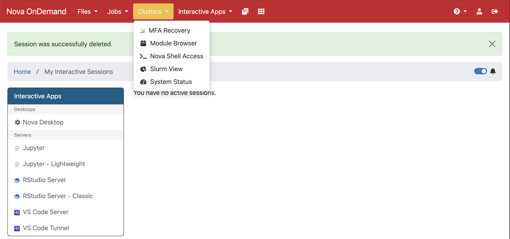
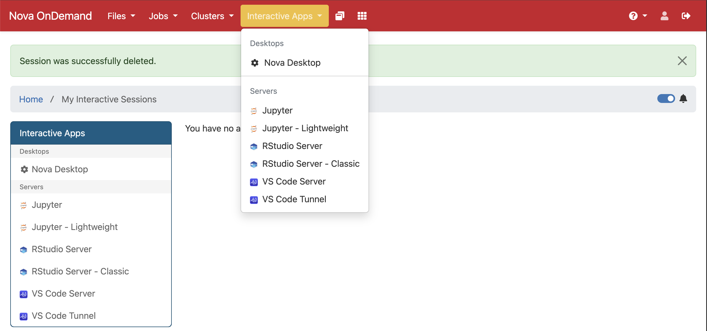
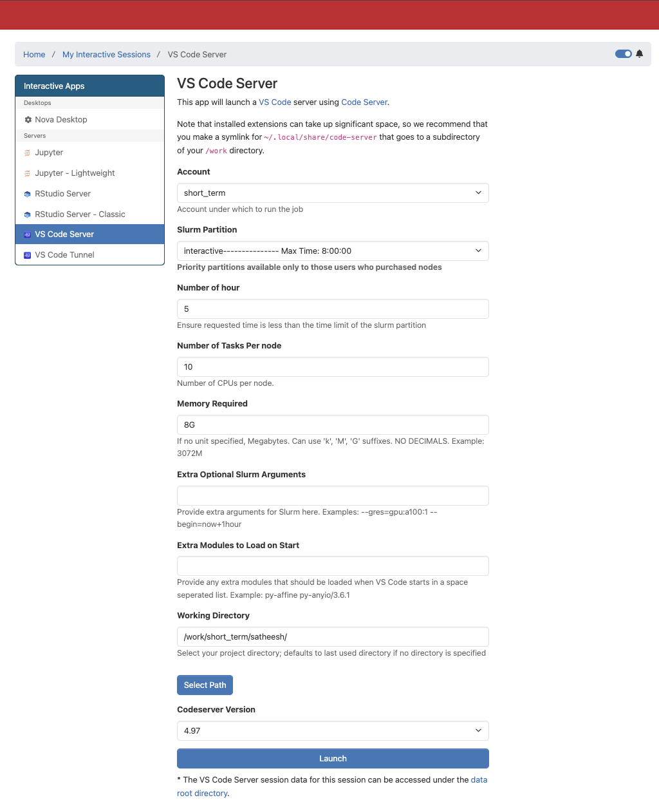

# Setup

Everything in this workshop runs from one project directory on Nova. Items marked TODO still need to be filled in.

## 1. Quick start: log in and open your work folder

(This is the same quick start as in the [Slurm workshop](https://github.com/ISUgenomics/isu-slurm-introduction-2026/blob/main/slurm_workshop.md).)

1. Log in to Nova OnDemand through a browser: [https://nova-ondemand.its.iastate.edu/](https://nova-ondemand.its.iastate.edu/)

2. From the top menu bar, choose **Clusters → Nova Shell Access**.

   

3. In the shell that opens, check where you are:

```bash
pwd
```

<details>
<summary>Output</summary>
<pre>
/home/$USER
</pre>
</details>

   Go to the workshop work area:

```bash
cd /work/short_term
```

   Make your own folder (`$USER` is your user name):

```bash
mkdir -p $USER
```

   Go into it:

```bash
cd $USER
```

4. Later we will edit scripts with VS Code Server. Open it from Nova OnDemand when needed: **Interactive Apps → VS Code Server**.

   

   Use these settings:

   ```
   Account: short_term
   Partition: interactive
   Number of hour: 5
   Number of Tasks per node: 10
   Memory Required: 8G
   Working Directory: /work/short_term/$USER
   ```

   The form should look similar to this before you click **Launch**:

   

## 2. Get an interactive session

Do not run the workshop commands on the head node. If you started VS Code Server with the settings above, you already have a session on a compute node. To get a session from a terminal instead, use:

```bash
salloc --account=short_term --partition=interactive --cpus-per-task=10 --mem=16G --time=04:00:00
```

For the workshop we use the account `short_term` and the partition `interactive`, the same as in the VS Code Server form.

## 3. Get the lesson files

The lessons are in a public GitHub repository. Clone it into your work folder (`/work/short_term/$USER`):

```bash
git clone https://github.com/ISUgenomics/isu-bash-pipeline-2026.git
```

The lessons are the numbered files in the new folder `isu-bash-pipeline-2026`: `00_setup.md`, `01_building_first_script.md`, `02_alignment_bwa.md` and `03_pipeline_combined.md`. You can open them in VS Code Server to read along. We do our own work in a **separate** project folder (next step), so the lesson files stay clean.

## 4. Create the project directory

Make the project folder (you should be in `/work/short_term/$USER`):

```bash
mkdir -p isu-bash-pipeline-workshop
```

Go into it:

```bash
cd isu-bash-pipeline-workshop
```

Make the folders we need:

```bash
mkdir -p 00_scripts 01_data 02_reference logs
```

Check where you are:

```bash
pwd
```

Every later command assumes your working directory is this folder.

## 5. Copy the data and reference

- Reads: 5 paired-end samples, `bio_sample_01_R1.fastq.gz` ... `bio_sample_05_R2.fastq.gz`, go in `01_data/`.
- Reference: the genome these reads come from, `b73_chr1_150000001-151000000.fasta` (a 1 Mb piece of maize chromosome 1), goes in `02_reference/`. The alignment lesson links it as `00_ref/genome.fa`.
- Size: the reads are about 580 MB in total (10 files of 34-140 MB each). The reference is about 1 MB.

Copy the reads from the workshop folder into `01_data/` (run this in your project folder, `isu-bash-pipeline-workshop`). It takes a few seconds:

```bash
cp /work/short_term/workshop_materials/satheesh_bash/01_data/*.fastq.gz 01_data/
```

Check that you have 10 files:

```bash
ls 01_data/
```

<details>
<summary>Output</summary>
<pre>
bio_sample_01_R1.fastq.gz  bio_sample_02_R1.fastq.gz  bio_sample_03_R1.fastq.gz  bio_sample_04_R1.fastq.gz  bio_sample_05_R1.fastq.gz
bio_sample_01_R2.fastq.gz  bio_sample_02_R2.fastq.gz  bio_sample_03_R2.fastq.gz  bio_sample_04_R2.fastq.gz  bio_sample_05_R2.fastq.gz
</pre>
</details>

TODO: add the copy command for the reference file (source path needed).

## 6. Check the tools

Start with a clean set of modules:

```bash
module purge
```

Load the four tools:

```bash
module load fastp parallel bwa samtools
```

Check that each tool runs:

```bash
fastp --version
```

```bash
parallel --version | head -n 1
```

```bash
bwa 2>&1 | grep Version
```

```bash
samtools --version | head -n 1
```

You may see an `Lmod Warning` about `zlib-ng` when you load `bwa`. It is harmless.

## 7. Editing files

Scripts are created in the editor (VSCode on OnDemand, or `nano 00_scripts/01_fastp.sh`). A script starts with a shebang line, `#!/usr/bin/env bash`, which tells the system to run it with bash. Make it runnable with `chmod +x` and run it with `./00_scripts/01_fastp.sh`.
