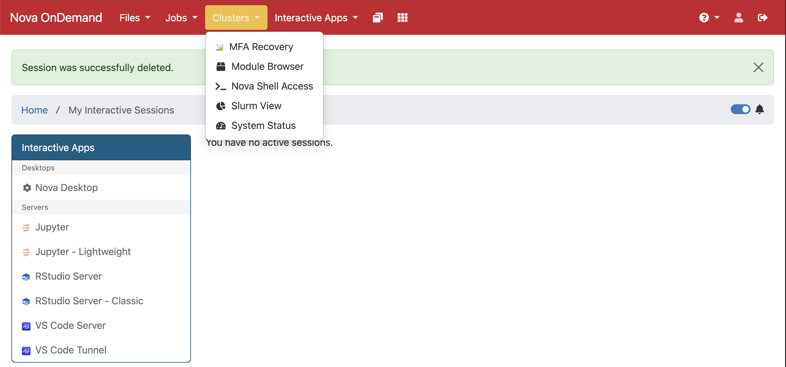
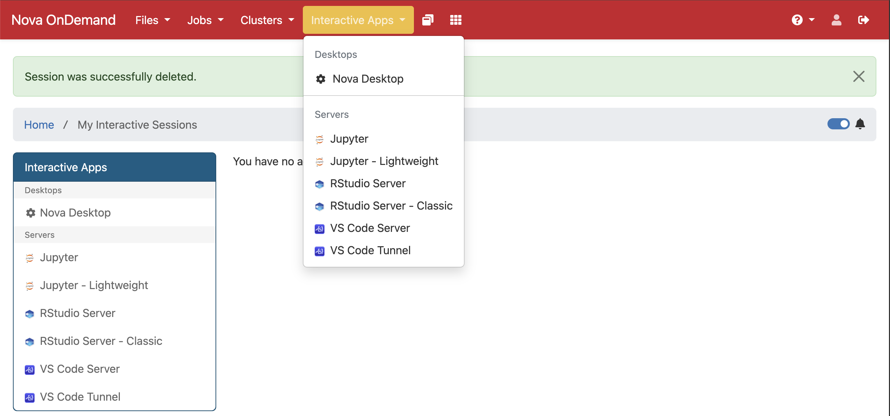
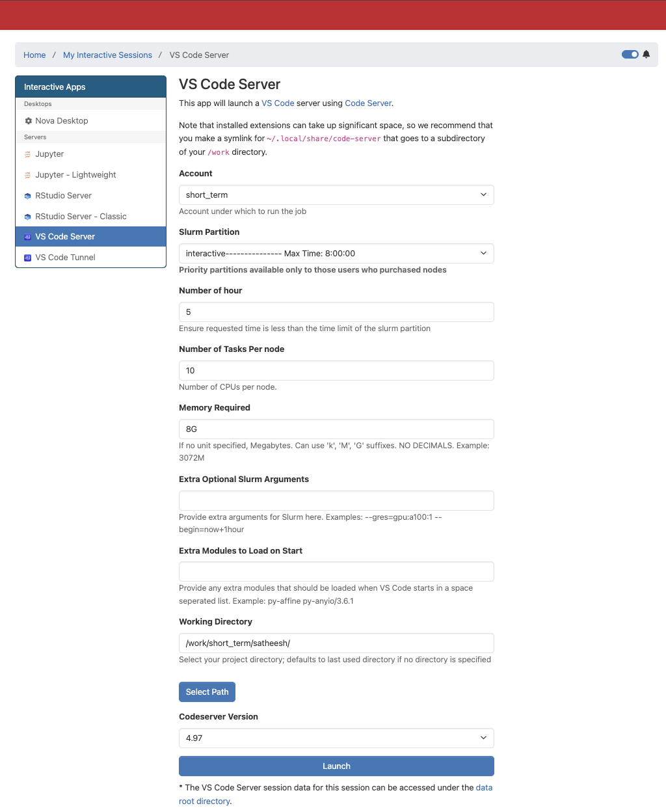

# Setup

Everything in this workshop runs from one project folder on Nova (`/work/short_term/$USER`). In this setup you log in, clone the lessons, copy the data and check the tools.

## 1. Quick start: log in and open your work folder

(This is the same quick start as in the [Slurm workshop](https://github.com/ISUgenomics/isu-slurm-introduction-2026/blob/main/slurm_workshop.md).)

1. Log in to Nova OnDemand through a browser: [https://nova-ondemand.its.iastate.edu/](https://nova-ondemand.its.iastate.edu/)

2. From the top menu bar, choose **Clusters → Nova Shell Access**.

   

3. In the shell that opens, check where you are:

```bash
pwd
```

<details>
<summary>Output</summary>
<pre>
/home/$USER
</pre>
</details>

   Go to the workshop work area:

```bash
cd /work/short_term
```

   Make your own folder (`$USER` is your user name):

```bash
mkdir -p $USER
```

   Go into it:

```bash
cd $USER
```

4. Later we will edit scripts with VS Code Server. Open it from Nova OnDemand when needed: **Interactive Apps → VS Code Server**.

   

   Use these settings:

   ```
   Account: short_term
   Partition: interactive
   Number of hour: 5
   Number of Tasks per node: 10
   Memory Required: 8G
   Working Directory: /work/short_term/$USER
   ```

   The form should look similar to this before you click **Launch**:

   

## 2. Get an interactive session (if using Shell)

Do not run the workshop commands on the head node. If you started VS Code Server with the settings above, you already have a session on a compute node. To get a session from a terminal instead, use:

```bash
salloc --account=short_term --partition=interactive --cpus-per-task=10 --mem=16G --time=04:00:00
```

For the workshop we use the account `short_term` and the partition `interactive`, the same as in the VS Code Server form.

## 3. Clone the repository

The lessons are in a public GitHub repository. Clone it into your work folder (`/work/short_term/$USER`):

```bash
git clone https://github.com/ISUgenomics/isu-bash-pipeline-2026.git
```

Go into the new folder to look at what is in it:

```bash
cd isu-bash-pipeline-2026
```

List what is in it:

```bash
ls
```

<details>
<summary>Output</summary>
<pre>
00_scripts  01_setup.md  02_building_first_script.md  03_alignment_bwa.md  04_pipeline_combined.md  assets  cheatsheet.md  exercises.md  LICENSE  README.md
</pre>
</details>

- `README.md` has the agenda of the workshop.
- `01_setup.md` is this page. `02_building_first_script.md`, `03_alignment_bwa.md` and `04_pipeline_combined.md` are the three lessons, in order.
- `cheatsheet.md` is a short list of the commands we use, and `exercises.md` has the exercises.
- `00_scripts/` has a copy of every script from the lessons (`01_fastp.sh` to `12_pipeline_array.sh`). We write the scripts ourselves in the lessons. If one of yours does not work, you can compare it with the copy here, or copy it into your own `00_scripts/` folder.
- `assets/` holds the screenshots, and `LICENSE` is the license.

You can open the lessons in VS Code Server to read along.

Now go back up one folder, to your work folder `/work/short_term/$USER`:

```bash
cd ..
```

This is our **project folder**. The lesson files stay in `isu-bash-pipeline-2026`, and we run everything and keep all our data and results here, in the project folder.

## 4. Copy the materials we need

The reads and the reference genome are in a shared folder. Copy both folders into the project folder (you must be in `/work/short_term/$USER`, one level above `isu-bash-pipeline-2026`). It takes a few seconds:

```bash
cp -r /work/short_term/pipeline_workshop_2026/* .
```

Check that they are there:

```bash
ls 01_data 02_reference
```

<details>
<summary>Output</summary>
<pre>
01_data:
bio_sample_01_R1.fastq.gz  bio_sample_02_R1.fastq.gz  bio_sample_03_R1.fastq.gz  bio_sample_04_R1.fastq.gz  bio_sample_05_R1.fastq.gz
bio_sample_01_R2.fastq.gz  bio_sample_02_R2.fastq.gz  bio_sample_03_R2.fastq.gz  bio_sample_04_R2.fastq.gz  bio_sample_05_R2.fastq.gz

02_reference:
b73_chr1_150000001-151000000.fasta
</pre>
</details>

- `01_data/` has the reads: 5 paired-end samples (`R1` and `R2` file for each). They are about 580 MB in total (10 files of 34-140 MB each).
- `02_reference/` has the reference genome these reads come from, `b73_chr1_150000001-151000000.fasta` (a 1 Mb piece of maize chromosome 1, about 1 MB). The alignment lesson uses it from there.

Check where you are:

```bash
pwd
```

<details>
<summary>Output</summary>
<pre>
/work/short_term/$USER
</pre>
</details>

Every later command assumes your working directory is this folder.

## 5. Check the tools

Start with a clean set of modules:

```bash
module purge
```

Load the four tools:

```bash
module load fastp parallel bwa samtools
```

Check that each tool runs:

```bash
fastp --version
```

```bash
parallel --version | head -n 1
```

```bash
bwa 2>&1 | grep Version
```

```bash
samtools --version | head -n 1
```

You may see an `Lmod Warning` about `zlib-ng` when you load `bwa`. It is harmless.

## 6. Editing files

Scripts are created in the editor (VSCode on OnDemand, or `nano 00_scripts/01_fastp.sh`). A script starts with a shebang line, `#!/usr/bin/env bash`, which tells the system to run it with bash. Make it runnable with `chmod +x` and run it with `./00_scripts/01_fastp.sh`.
